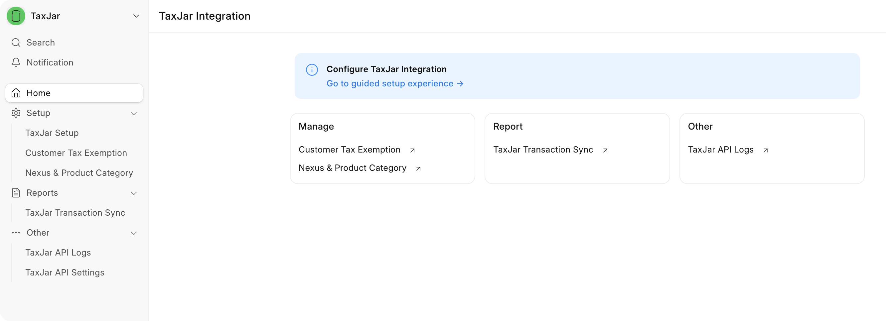
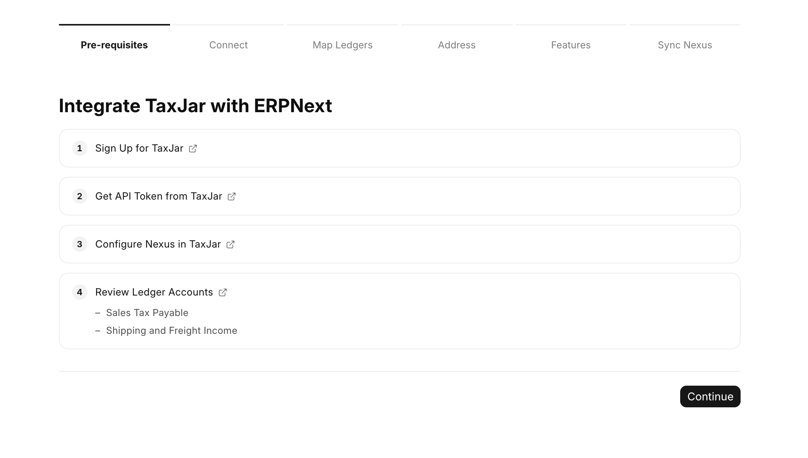
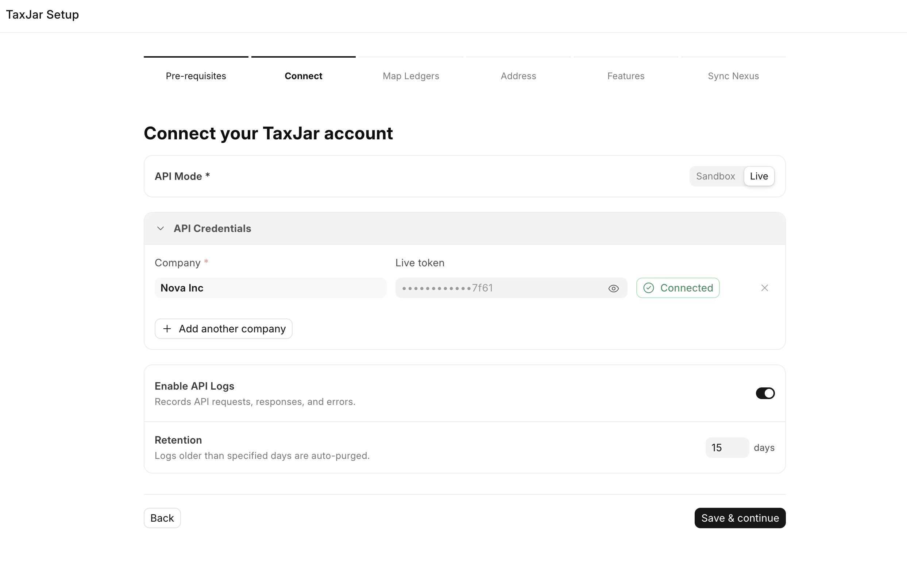
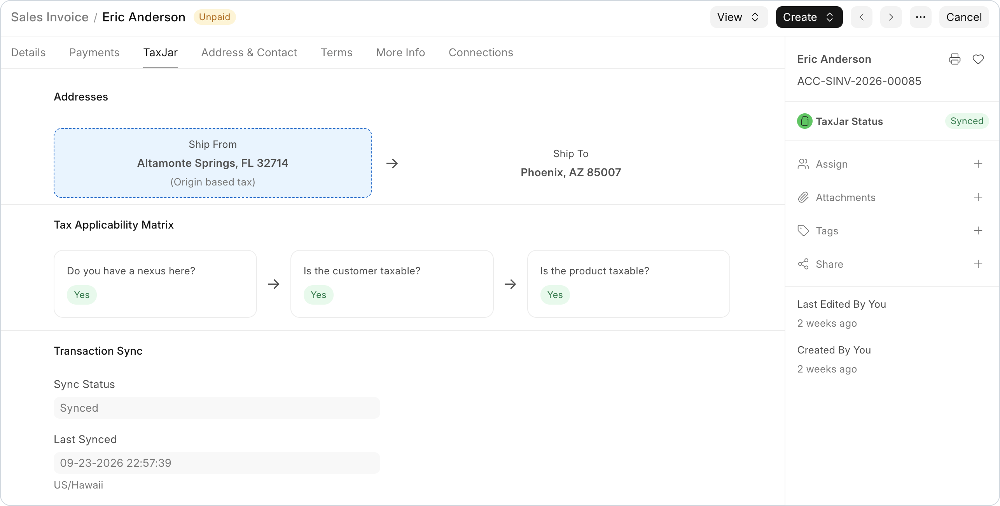
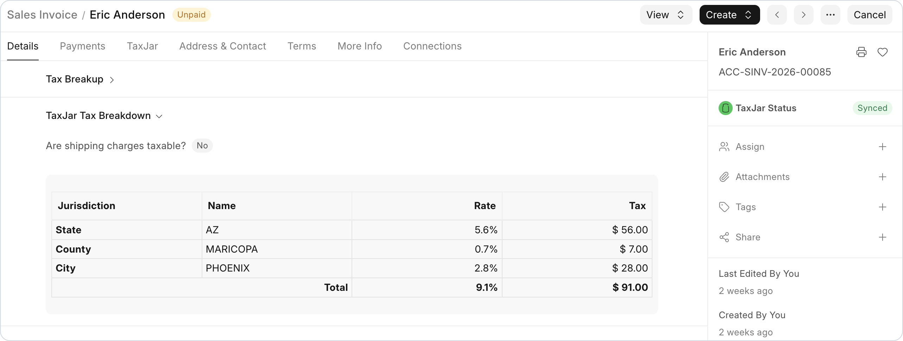
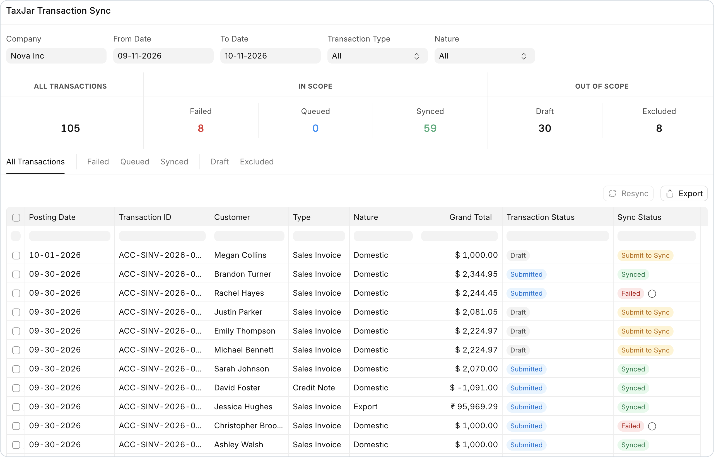
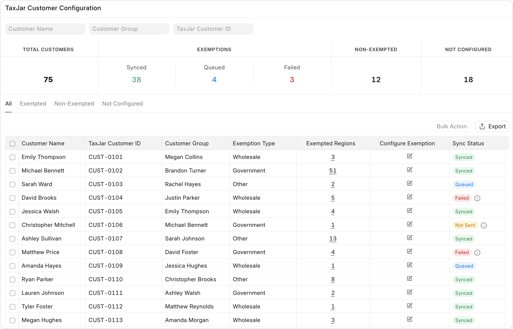

# TaxJar Integration for ERPNext

The TaxJar Integration calculates US sales tax on your ERPNext sales documents. It also sends your submitted invoices and credit notes to TaxJar, so that TaxJar AutoFile can file your sales tax returns.



## Features

- **Guided setup.** Six steps connect each company to TaxJar. You do not edit a settings form.
- **Sales tax on each save.** The app calculates the tax on Quotation, Sales Order and Sales Invoice when you save a draft.
- **Transaction sync.** The app sends submitted invoices and credit notes to TaxJar. It deletes them in TaxJar when you cancel them.
- **More than one company.** Each company has its own API token, ledgers, address and features.
- **Nexus from TaxJar.** The app reads your nexus states from TaxJar and updates them each day.
- **Product tax categories.** You set a TaxJar category on each item, for example clothing or food.
- **Customer exemptions.** You set exemptions on one customer or on many customers. The app sends them to TaxJar.
- **Period close.** The TaxJar Transaction Sync page shows the sync status of each invoice and credit note.
- **API log.** Each request to TaxJar and its response go into the TaxJar API Log.

## Screenshots

### Guided setup

The Pre-requisites step lists what to prepare in TaxJar and in ERPNext before you connect.



The Connect step links each company to its TaxJar account.



### Sales tax on an invoice

The TaxJar tab shows the addresses, the Tax Applicability Matrix and the sync status.



The TaxJar Tax Breakdown shows the tax for each jurisdiction.



### Transaction sync

The TaxJar Transaction Sync page shows the sync status of each invoice and credit note.



### Customer exemptions

The customer page shows the exemption and the sync status of each customer.



## Requirements

- Frappe Framework and ERPNext, the `develop` branch.
- Python 3.14 or later.
- A TaxJar account and an API token for each company. Sign up at [app.taxjar.com](https://app.taxjar.com/api_sign_up).
- A company with the country "United States". TaxJar calculates US sales tax only.

## Installation

Run these commands in your bench folder:

```bash
bench get-app https://github.com/frappe/taxjar_integration
bench --site <site-name> install-app taxjar_integration
bench --site <site-name> migrate
```

## Get started

1. Open the **TaxJar** app from the ERPNext apps screen.
2. Click **Go to guided setup experience →** in the blue banner.
3. Complete the six steps: **Pre-requisites**, **Connect**, **Map Ledgers**, **Address**, **Features** and **Sync Nexus**.
4. Set a product tax category on each item.
5. Make a sales invoice and save it. The app adds a **Sales Tax** row with the amount from TaxJar.
## User guide

With this app, you can:

- prepare the TaxJar account, the API token and the ledgers,
- complete the guided setup,
- set nexus states, product tax categories and customer exemptions,
- submit, return and cancel invoices,
- close a period before TaxJar AutoFile files the return,
- find and fix problems with the TaxJar API Log,
- give users the correct roles.

## Development

### Server tests

The server tests need a site with ERPNext and this app installed.

```bash
bench --site <site-name> set-config allow_tests true
bench --site <site-name> run-tests --app taxjar_integration
```

### Client tests

The client tests check the desk scripts. They use Vitest and need Node.js 24 or later. They do not need a site.

```bash
npm ci
npm test
```

### Static checks

The CI runs the [Frappe Semgrep rules](https://github.com/frappe/semgrep-rules) and the app convention checks:

```bash
python scripts/audit_conventions.py
```

### Dependencies

- `pyproject.toml` holds the Python dependencies. The app has no `setup.py`.
- `requirements.txt` is a stub for older tools. Do not add dependencies to it.

## Contributing

1. Fork the repository.
2. Make a branch from `develop`.
3. Add or update the tests for your change.
4. Run the server tests and the client tests.
5. Open a pull request against `develop`. Give the steps to reproduce the problem and the expected result.

## License

MIT. Refer to [license.txt](license.txt).
