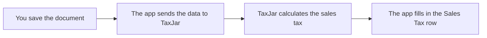

# Tax Computation

When you save a quotation, a sales order, a sales invoice, a credit note or a debit note, the app gets the sales tax from TaxJar. You do not click a button, and any user who can save the document gets the tax.

If the data did not change since the last calculation, the app keeps the tax. Refer to [Recalculation Rules](#recalculation-rules).

## Quotes, Orders & Invoices

All five sales documents get sales tax when you save them. Only sales invoices, credit notes and debit notes go to TaxJar when you submit them. Refer to [Syncing to TaxJar](/transaction-sync/syncing-to-taxjar).

| Document | Tax on Save | Sent on Submit | Sent As |
|---|:-:|:-:|---|
| Quotation | ● | | - |
| Sales Order | ● | | - |
| Sales Invoice | ● | ● | TaxJar Order |
| Credit Note | ● | ● | TaxJar Refund |
| Debit Note | ● | ● | TaxJar Order |

## Parameters for Tax

| Data | Comes from |
|---|---|
| **Ship from** | The company address with **Preferred Billing Address** set. TaxJar Setup sets it. |
| **Ship to** | The **Shipping Address** of the document. If it is empty, the app asks for one when you save. |
| **Items** | The rate, the quantity and the discount of each item row. |
| **Product tax category** | The **Product Tax Category** of each item. Refer to [Item Tax Exemption](/tax-exemptions/item-tax-exemption). |
| **Shipping** | The rows on the company's shipping ledger account. |
| **Other charges and discounts** | The other rows of the taxes table. Refer to [Additional Charges & Discounts](/sales-tax/additional-charges-and-discounts). |
| **Exemption** | The exemption of the customer, or of the document. |
| **Currency** | A document in another currency is converted to USD with the ERPNext exchange rate. TaxJar's answer is converted back. |

## Taxability Checks

TaxJar charges sales tax only when all three answers are yes. The **TaxJar** tab of the document shows the three answers. Refer to [Verify Tax Applicability](/sales-tax/verify-tax-applicability).

1. **Do you have nexus in the ship-to state?** If not, no tax.
2. **Is the customer taxable?** An exempt customer, or a sale marked as exempt, pays no tax.
3. **Is the product taxable?** The state may not tax the product tax category of an item.

The state also decides which address gives the rate:

| State type | Rate of |
|---|---|
| **Origin-based** | The ship-from address |
| **Destination-based** | The ship-to address |

## Skipped Calculations

In these cases, the app does not ask TaxJar. Every message and its fix is in [Messages & Errors](/troubleshoot/messages-and-errors).

| Case | Result |
|---|---|
| **The ship-to country is not the United States** | An export. No US sales tax. |
| **The document has no address** | No tax. The form asks for an address. |
| **The company does not calculate tax** | No tax. **Compute Taxes on Sales** is off for the company in TaxJar Setup, or TaxJar is off for the site. |
| **TaxJar cannot be reached** | The document saves without new tax, with an orange message. Save it again later. |

## Recalculation Rules

The app keeps the sales tax, and does not ask TaxJar again, when all of these are true:

- The data that TaxJar uses did not change. Refer to [Parameters for Tax](#parameters-for-tax).
- The app calculated the tax in the current calendar month.
- Nobody saved TaxJar Setup after the calculation.
- The **Sales Tax** row still has the amount that TaxJar calculated.

This applies when you save a document again, and when you make a sales order from a quotation or an invoice from an order. The new document keeps the tax of the source document, so one sale needs only one request to TaxJar.

The app asks TaxJar again when one of these is not true, or when you invoice only a part of an order. For example, if you change the tax amount, or add a second row on the sales tax account, the app asks TaxJar again.

::: info Why a new month gets a new calculation
TaxJar always uses the rates of the day of the request, and most states and cities change rates on the first day of a month. In a new month, the app asks TaxJar again to get the current rates.
:::
